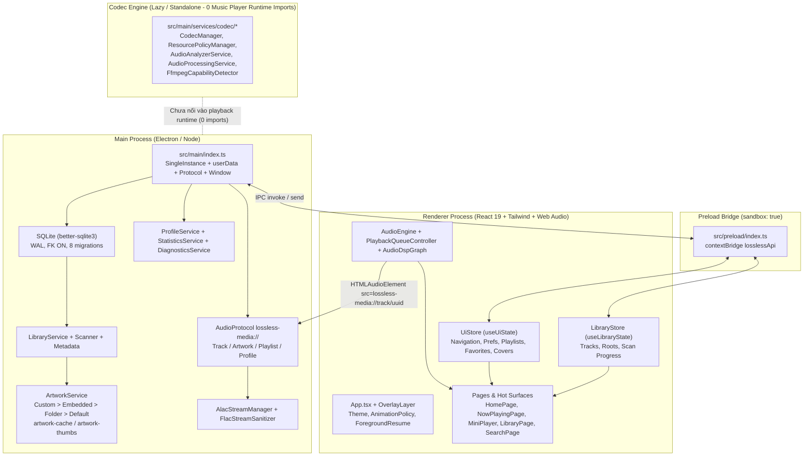

# DOREMI — PHASE 5.1A: DEEP SYSTEM AUDIT & ARCHITECTURE MAPPING

**Ngày thực hiện**: 2026-11-26  
**Phạm vi**: Toàn bộ ứng dụng DoReMi Desktop (`src/main`, `src/preload`, `src/renderer`, `src/shared`, `scripts`) trên nền tảng Phase 4.5.1 hiện hữu.  
**Mục tiêu**: Lập bản đồ kiến trúc thực tế từ source code, đo baseline trước tối ưu, và xác định các điểm nghẽn có bằng chứng đo lường trước khi bước vào `Phase 5.1B → 5.1G`.

---

## 1. Bản đồ Kiến trúc & Dòng chảy Runtime (Architecture Map)

### 1.1 Các luồng thực thi chính đã kiểm toán trực tiếp

1. **Startup Flow (`src/main/index.ts`, `src/main/windows/main-window.ts`, `src/renderer/src/app/App.tsx`)**:
   - Main đặt `userData`, gọi `registerPrivilegedAudioScheme()`, xin `requestSingleInstanceLock()`, sau `app.whenReady()` gọi `initializeApplication()`: mở SQLite (`openLibraryDatabase`, WAL + FK + `synchronous=NORMAL`), khởi tạo 7 repository + 6 service, gắn CSP `onHeadersReceived`, đăng ký `lossless-media://`, đăng ký IPC (`registerIpcHandlers`), tạo `BrowserWindow` (`show: false` → `ready-to-show` → `show()`), sau 1500ms chạy `revalidateLegacyMetadata()` nếu có track `metadata_version < 2`.
   - Renderer tải **1 bundle JS duy nhất** (`out/renderer/assets/index-*.js` = `1,743.17 kB`, CSS `126.02 kB`), khởi tạo `libraryStore.initialize()` + `uiStore.hydrateFromDesktop()`.

2. **Playback & DSP Flow (`src/renderer/src/player/audio-engine.ts`, `audio-dsp.ts`, `src/main/services/audio-stream-handler.ts`, `alac-decoder.ts`, `flac-stream-sanitizer.ts`)**:
   - `AudioEngine` xác minh file qua IPC `VERIFY_TRACK`, gán `lossless-media://track/<uuid>` vào `HTMLAudioElement`, nối tối đa 1 lần qua `WeakSet<object>` vào `AudioDspGraph` (hoặc giữ Direct Path / ReplayGain khi tắt EQ).
   - Main stream qua `resolveTrackMediaResponse` hỗ trợ HTTP `206 Partial Content`: FLAC sạch đi **zero-copy stream** (`flac-stream-sanitizer` có LRU cache 64 header plans); ALAC decode off-disk qua `@mgz-dev/alac` (`AlacStreamManager`, tối đa 2 open tracks LRU, idle eviction 30s).
   - `AudioEngine` lắng nghe `timeupdate`, cập nhật `currentTimeSeconds`, checkpoint session thống kê mỗi khoảng nhất định và gọi `emitState()` để thông báo toàn bộ subscriber của `usePlaybackState()`.

3. **UI State & Render Fan-out Flow (`src/renderer/src/stores/ui-store.ts`, `player-store.ts`, `library-store.ts`)**:
   - `player-store.ts` đã khai báo `usePlaybackStatus()`, `usePlaybackQueueState()`, `useAudioDspState()` và `usePlaybackState()`, nhưng đa số màn hình nặng (`LibraryPage`, `TrackList`, `MiniPlayer`, `AudioLabPage`, `NowPlayingPage`) đều gọi `usePlaybackState()`.
   - `uiStore.getUnifiedTracks()` và `uiStore.getDerivedAlbums()` biến đổi toàn bộ `libraryStore.getSnapshot().tracks` (và tính `computePaletteFromSeed`, `formatTrackAudioSpecs`, `buildAlbumIdSlug`) **trực tiếp khi hàm được gọi** mà chưa memoize theo reference của `library.tracks`.

4. **Library Scan & Artwork Flow (`src/main/services/library-service.ts`, `scanner-service.ts`, `artwork-service.ts`)**:
   - `getSnapshot()` đọc `trackRepo.findAll()` rồi chạy `artworkService.enrichTracks(rawTracks)`.
   - `rescanLibrary()` kiểm tra từng track trong DB tuần tự 1-by-1 (`await inspectFile`), sau đó quét đệ quy toàn bộ thư mục gốc và đẩy toàn bộ danh sách file tìm thấy (kể cả file không đổi) vào `importFiles()`, gây kiểm tra/ghi lặp nhiều lần.

5. **Codec Engine Isolation (`src/main/services/codec/*`)**:
   - Đã xác minh bằng tìm kiếm toàn bộ `src/` ngoài `src/main/services/codec/`: **0 runtime imports** từ Main/Preload/Renderer Music Player sang Codec Engine. Cô lập hoàn toàn đúng Priority 5–6.

---

## 2. Danh sách Điểm Nghẽn Thực Tế Có Bằng Chứng (Ranked Bottleneck Inventory)

| Hạng | ID | Module / Vị trí cụ thể | Vấn đề thực tế trong code | Bằng chứng đo đạc / quan sát | Giai đoạn xử lý |
|---|---|---|---|---|---|
| 1 | `BN-01` | [artwork-service.ts](file:///g:/Source%20code%20DoReMi/src/main/services/artwork-service.ts#L213-L279) | `resolveArtworkFieldsFromRow()` gọi tới 3 lần `fsSync.existsSync(...)` **cho mỗi track** bên trong `enrichTracks()` trên mọi lần `getSnapshot()`. | 50k tracks: SQLite `findAll = 265.21 ms`, nhưng `enrichTracks = 3,358.16 ms` (`getSnapshot = 3,578.66 ms`), chậm gấp ~12.6× SQLite ngay cả trên NVMe. | `5.1F` / `5.1C` |
| 2 | `BN-02` | [LibraryPage.tsx](file:///g:/Source%20code%20DoReMi/src/renderer/src/pages/LibraryPage.tsx#L86), [MiniPlayer.tsx](file:///g:/Source%20code%20DoReMi/src/renderer/src/components/MiniPlayer.tsx#L26), [TrackList.tsx](file:///g:/Source%20code%20DoReMi/src/renderer/src/components/TrackList.tsx#L13), [AudioLabPage.tsx](file:///g:/Source%20code%20DoReMi/src/renderer/src/pages/AudioLabPage.tsx#L36), [NowPlayingPage.tsx](file:///g:/Source%20code%20DoReMi/src/renderer/src/pages/NowPlayingPage.tsx#L126) | `usePlaybackState()` re-render toàn bộ component ở tần số `timeupdate` (~4 Hz). `LibraryPage`, `TrackList`, `AudioLabPage` không dùng `currentTimeSeconds` vẫn re-render 4 lần/giây; `MiniPlayer` & `NowPlayingPage` quét `library.tracks.find()` tuyến tính $O(N)$ mỗi tick. | Quan sát trực tiếp call sites `usePlaybackState()` & `AudioEngine.emitState()` trên event `timeupdate`. | `5.1D` / `5.1E` |
| 3 | `BN-03` | [LibraryPage.tsx](file:///g:/Source%20code%20DoReMi/src/renderer/src/pages/LibraryPage.tsx#L801-L840), [SearchPage.tsx](file:///g:/Source%20code%20DoReMi/src/renderer/src/pages/SearchPage.tsx#L17-L55) | `LibraryPage` render toàn bộ `filteredTracks.map(...)` ra DOM không dùng windowed virtualization (`5,000–50,000` DOM nodes), lại chạy `ui.favoriteIds.includes(track.id)` $O(F)$ cho từng dòng. `SearchPage` cũng render unvirtualized và chuẩn hóa lại chuỗi tìm kiếm trên mọi track × mọi field × mọi ký tự gõ. | `LibraryPage.tsx:802` (`filteredTracks.map`), `LibraryPage.tsx:805` (`includes`); `vietnamese-search` 50k tracks ~`150.09 ms` chỉ cho 1 lượt match đơn giản. | `5.1E` |
| 4 | `BN-04` | [ui-store.ts](file:///g:/Source%20code%20DoReMi/src/renderer/src/stores/ui-store.ts#L2634-L2752) | `getUnifiedTracks()` và `getDerivedAlbums()` cấp phát mới toàn bộ mảng `PrototypeTrack[]`, `Map`, `computePaletteFromSeed` trên mỗi lần gọi; bị gọi trực tiếp trong render (`LibraryPage`, `SearchPage`, `EditorialAlbumGallery`, `AlbumDetailPage`, `ArtistDetailPage`, `PlaylistDetailPage`, `PlaybackQueuePanel`). | Mỗi lần `uiStore` hoặc `playback` re-render đều tái tạo toàn bộ object array + derived album map. | `5.1E` |
| 5 | `BN-05` | [library-service.ts](file:///g:/Source%20code%20DoReMi/src/main/services/library-service.ts#L652-L675), [library-service.ts](file:///g:/Source%20code%20DoReMi/src/main/services/library-service.ts#L819-L977) | `rescanLibrary()` stat tuần tự 1-by-1 toàn bộ `scopedTracks`, gọi `findMostSpecificWatchedRootId` $O(N \times R)$ và đẩy cả các file **không đổi** qua `importFiles()` (stat + lookup DB nhiều lần + phát IPC progress từng file). Ngoài ra track `artwork_source === 'default'` có thể bị quét lại auto-artwork ở các lần rescan khi chưa ghi nhận trạng thái `checked_mtime_ms`. | Benchmark `incrementalRescan1000` với 1,000 file không đổi mất `2,514.14 ms`. | `5.1F` |
| 6 | `BN-06` | [electron.vite.config.ts](file:///g:/Source%20code%20DoReMi/electron.vite.config.ts#L48-L65), [App.tsx](file:///g:/Source%20code%20DoReMi/src/renderer/src/app/App.tsx) | Bundle renderer là 1 file JS monolithic `1,743.17 kB` (1,734 modules), parse/compile toàn bộ mọi trang (`AudioLabPage`, `StatisticsPage`, `VinylStoryboardPage`, `SettingsPage`, `LibraryPage`, `SearchPage`) ngay lúc cold start dù người dùng mở ở `HomePage`. | Output `npm run build`: `index-DHD-ow8A.js 1,743.17 kB`. | `5.1B` |
| 7 | `BN-07` | [profile-service.ts](file:///g:/Source%20code%20DoReMi/src/main/services/profile-service.ts#L287-L323), [profile-service.ts](file:///g:/Source%20code%20DoReMi/src/main/services/profile-service.ts#L481-L555) | `getProfile()` và `getPreferences()` tạo `db.prepare(...)` mới và chạy `fs.existsSync(...)` đồng bộ mỗi lần gọi; chưa cached in-memory invalidating on write. | Benchmark 200 calls = `8.33 ms` kèm disk stat lặp lại trên main thread. | `5.1B` / `5.1C` |
| 8 | `BN-08` | [FocusMinimalLyrics.tsx](file:///g:/Source%20code%20DoReMi/src/renderer/src/components/FocusMinimalLyrics.tsx), [NowPlayingPage.tsx](file:///g:/Source%20code%20DoReMi/src/renderer/src/pages/NowPlayingPage.tsx) | Khi phát trong Focus Vinyl / Now Playing, `timeupdate` 4Hz buộc toàn bộ `NowPlayingPage` re-render và tính lại radial geometry / CSS gradient strings dù active lyric index chỉ đổi vài giây một lần. Ngoài ra cache `artwork-cache/` + `artwork-thumbs/` chưa có cleanup orphan / bound LRU. | `adaptiveArtwork` pixel analysis `127.5 ms` cho 200 lượt (`~0.64 ms/lần`), nhưng canvas blur snapshot + layout recalc chạy trên main renderer thread khi crossfade/tick. | `5.1C` / `5.1E` |
| 9 | `BN-09` | [vietnamese-search.ts](file:///g:/Source%20code%20DoReMi/src/renderer/src/utils/vietnamese-search.ts#L13-L38), [natural-sort.ts](file:///g:/Source%20code%20DoReMi/src/shared/utils/natural-sort.ts) | `matchesVietnameseQuery(target, query)` chuẩn hóa lại `query` mỗi lần gọi; `naturalCompare` / `Intl.Collator` chạy trực tiếp trong callback `.sort()` $O(N \log N)$ lần không cache key. | 50k tracks: `vietnameseSearch = 150.09 ms`, `naturalSort = 134.39 ms`. | `5.1E` / `5.1F` |
| 10 | `BN-10` | [codec-manager.ts](file:///g:/Source%20code%20DoReMi/src/main/services/codec/codec-manager.ts), [ffmpeg-capabilities.ts](file:///g:/Source%20code%20DoReMi/src/main/services/codec/ffmpeg-capabilities.ts) | Cold inventory đã tốt (`7.79 ms`, warm `0 ms`), `FfmpegCapabilityDetector` đã có 8-entry LRU cache và `ResourcePolicyManager` mặc định `Power Saving (concurrency = 1)`. Tuy nhiên cần rà soát kỹ luồng hủy process / memory cleanup trong `AudioProcessingService` và đảm bảo playback priority throttle khi phát nhạc + convert song song. | Cold `7.79 ms`, warm `0 ms`; cần audit chi tiết luồng FFmpeg/job cleanup ở `5.1G`. | `5.1G` |

### 2.1 Phát hiện phụ trợ (Không tự ý xóa khi chưa xác minh an toàn)
- `src/assets/images/` chứa 7 file `.jpg` (~5.35 MB) không còn được import vào bundle production (`out/renderer` không chứa 7 file này), phù hợp `ISS-OPEN-09` trong `.ai-context`. Có thể ghi nhận hoặc xử lý sạch nếu không phá test/script nào.

---

## 3. Kết luận Kiểm toán 5.1A
Kiến trúc nền tảng của DoReMi **tốt ở lõi audio & data integrity** (SQLite WAL + FK, `flac-stream-sanitizer` có LRU + zero-copy, `AlacStreamManager` LRU giới hạn 2 track, `PlaybackQueueController` rất nhanh ngay cả ở 5,000 tracks, `Codec Engine` cô lập hoàn toàn `0` runtime imports).

Điểm nghẽn lớn nhất nằm ở **4 trục chính**:
1. **Main Process Disk Stat Loop (`BN-01`, `BN-05`)**: `ArtworkService.enrichTracks()` và `rescanLibrary()` đẩy chi phí từ mili-giây lên nhiều giây khi thư viện tăng lên `5,000–50,000` bài.
2. **Renderer `timeupdate` Re-render Fan-out (`BN-02`)**: Các component nặng như `LibraryPage`, `TrackList`, `AudioLabPage`, `MiniPlayer`, `NowPlayingPage` re-render ~4 lần/giây dù không cần hoặc có thể tách sub-component thời gian.
3. **Uncached Derived Selectors & Non-virtualized Large Lists (`BN-03`, `BN-04`, `BN-09`)**: `uiStore.getUnifiedTracks()`/`getDerivedAlbums()`, `LibraryPage`, `SearchPage` chưa cache và chưa virtualize danh sách lớn.
4. **Monolithic Renderer Startup Bundle (`BN-06`)**: `1,743.17 kB` bundle đơn được parse cùng lúc ở lần mở app đầu tiên.
