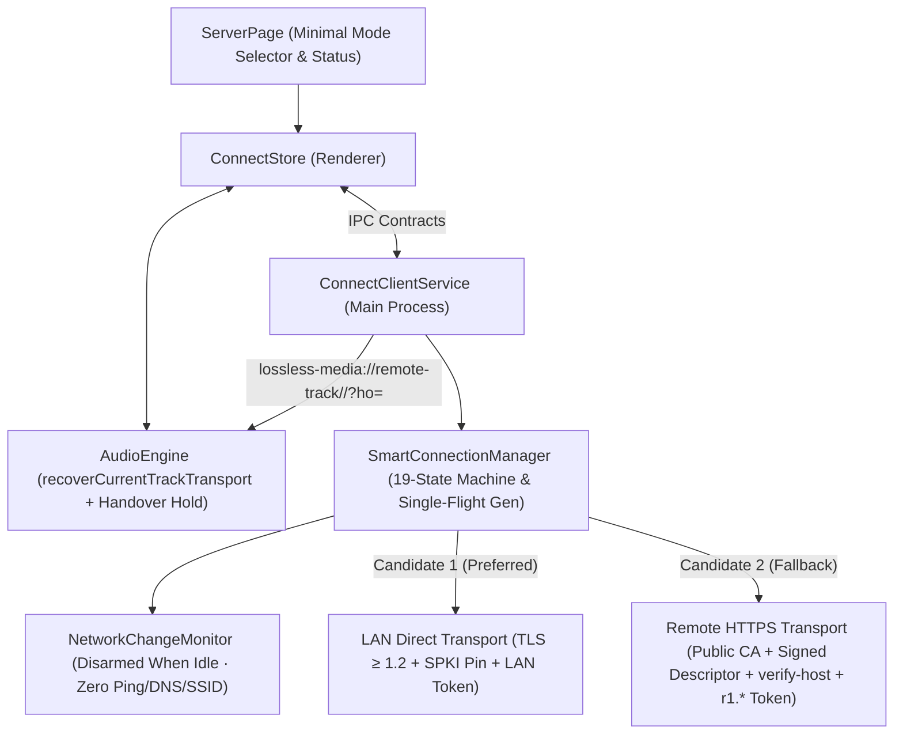

# DoReMi — Phase 6.4 Smart Connection Architecture

- **Version**: `1.0.0-rc.8` (`Phase 6.4`)
- **Status**: `IMPLEMENTATION COMPLETE · AUTOMATED & CHROMIUM HANDOVER VERIFIED · PHYSICAL NETWORK UAT PENDING`
- **Core Modules**:
  - [`src/main/services/connect/smart-connection-manager.ts`](file:///G:/Source%20code%20DoReMi/src/main/services/connect/smart-connection-manager.ts)
  - [`src/main/services/connect/network-monitor.ts`](file:///G:/Source%20code%20DoReMi/src/main/services/connect/network-monitor.ts)
  - [`src/main/services/connect/connect-client.ts`](file:///G:/Source%20code%20DoReMi/src/main/services/connect/connect-client.ts)
  - [`src/renderer/src/player/audio-engine.ts`](file:///G:/Source%20code%20DoReMi/src/renderer/src/player/audio-engine.ts)
  - [`src/renderer/src/stores/connect-store-core.ts`](file:///G:/Source%20code%20DoReMi/src/renderer/src/stores/connect-store-core.ts)
  - [`src/shared/contracts/media-protocol.ts`](file:///G:/Source%20code%20DoReMi/src/shared/contracts/media-protocol.ts)

---

## 1. Architectural Role & Isolation Boundaries

Phase 6.4 introduces `SmartConnectionManager` as a **transport-orchestration layer** sitting cleanly above the Phase 6.1–6.2 LAN Direct TLS SPKI-pinned transport and the Phase 6.3 Remote HTTPS (`TailscaleFunnelProvider` + `RemoteGatewayService`) transport, and below `ConnectStore` + `AudioEngine`:

### Strict Architectural Invariants
1. **Local Playback Zero-Overhead Isolation**: When the user plays local files (`ConnectHostService` `STOPPED`, `ConnectClientService` `DISCONNECTED`), `NetworkChangeMonitor.isRunning() === false` and `SmartConnectionManager.getActiveTimerCount() === 0`. Zero background polling, zero sockets, zero Tailscale CLI invocations.
2. **Orchestration Only — Never Duplicates Low-Level Internals**: `SmartConnectionManager` depends strictly on the platform-neutral `SmartConnectionDriver` interface (`prepareLanTransport`, `prepareRemoteTransport`, `probeActiveTransportHealth`, `discoverLanCandidates`, `commitPreparedSession`, `clearActiveSession`). It never parses X.509 ASN.1, never spawns `tailscale.exe`, and never touches WASM ALAC decoding buffers.
3. **Host Identity Is `hostId` + Cryptographic SPKI Fingerprint**: Remembered Hosts are keyed exclusively by lowercase UUID-shaped `hostId` derived from the Host's ECDSA P-256 SPKI SHA-256 digest. Two Hosts sharing an identical `displayName` never merge state, credentials, or endpoints.

---

## 2. Explicit 19-State Connection State Machine & Generation Safety

`SmartConnectionState` (`src/shared/types/connect.ts`) defines 19 explicit states:

| Group | States | Meaning |
|---|---|---|
| **Idle** | `DISCONNECTED` | No intended Host; monitor disarmed; zero timers. |
| **Evaluation & Verification** | `CHECKING_NETWORK`, `DISCOVERING_LAN`, `VERIFYING_LAN`, `CONNECTING_LAN`, `VERIFYING_REMOTE`, `CONNECTING_REMOTE` | Single-flight transport evaluation (`connectionGeneration` + `AbortController`). |
| **Connected** | `CONNECTED_LAN`, `CONNECTED_REMOTE` | Cryptographically verified active transport. |
| **Handover & Recovery** | `HANDOVER_PENDING`, `HANDOVER_IN_PROGRESS`, `RECONNECTING`, `DEGRADED` | Active transport handover or bounded retry/glitch absorption; Remote Library & Queue remain intact. |
| **Resting Network Outage** | `HOST_UNAVAILABLE`, `NETWORK_UNAVAILABLE` | Bounded retries reached (`maxAutoReconnectAttempts = 6`) or all OS network interfaces offline; rests with `0` active retry timers until OS network changes or user clicks Retry. |
| **Terminal Policy / Security** | `AUTHORIZATION_REQUIRED`, `ACCESS_REVOKED`, `SECURITY_BLOCKED`, `ERROR` | Non-retryable authorization or cryptographic verification block (`0` auto-retries). |

### Single-Flight Concurrency & Cancellation (`connectionGeneration`)
Every `connect()`, `setConnectionMode()`, `disconnect()`, emergency recovery, or debounced network re-evaluation increments a monotonic `connectionGeneration` and aborts the previous `AbortController`. Stale async responses (`!this.isCurrentGen(gen, signal)`) are discarded without mutating active transport state.

---

## 3. Resource-Efficient Network Change Detection (`NetworkChangeMonitor`)

`NetworkChangeMonitor` (`src/main/services/connect/network-monitor.ts`) combines two zero-privacy-risk signals only while armed (`intendedHostId !== null`):
1. **Renderer / OS `online` & `offline` Events**: Forwarded via `CONNECT_CLIENT_NOTIFY_NETWORK_HINT` (`window.addEventListener('online' | 'offline')`).
2. **In-Memory Local IPv4 Interface Signature Diff (`os.networkInterfaces()`)**: Sampled every `4,000 ms` (`timer.unref()`) only while armed, comparing sorted `<adapter>=<ipv4>/<netmask>` strings.
3. **Active Request / Stream Evidence**: Successful API/Range responses call `recordTransportSuccess()`; stream/API socket failures call `reportTransportFailure()`.

**Privacy Guarantees**: Zero external HTTP/ICMP pings, zero third-party DNS lookups, zero Tailscale CLI calls on the Client, zero Wi-Fi SSID/BSSID inspection, zero MAC address logging, and zero geolocation APIs.

---

## 4. Secure mDNS LAN Host Rediscovery

When a remembered Host's cached `lastAddress:port` fails with a `recoverable_network` error in `Automatic` or `LAN Only` mode:
1. `SmartConnectionManager` performs a bounded (`1,200 ms`) mDNS `_doremi._tcp.local` scan via `LanDiscoveryService.scanLanHosts()`.
2. Only advertisements matching `cand.hostId === host.hostId` on eligible private LAN IPv4 addresses are tested.
3. Each candidate must pass full TLS SPKI SHA-256 fingerprint pinning + `/api/v1/capabilities` + authenticated `/api/v1/library/summary` **before** `connect_remembered_hosts.last_address` / `port` is updated.
4. **Anti-DoS Spoof Resilience**: Because multicast mDNS is unauthenticated UDP, an untrusted LAN responder advertising `hostId` with a mismatched TLS certificate is rejected with `0` credentials transmitted and skipped (`continue`) so it **cannot** poison valid mDNS candidates or DoS `Remote HTTPS` fallback.

---

## 5. Future Android Single-APK Smart Connection Contract

The `SmartConnectionManager` state machine, handover rules, and security boundaries are designed for direct parity in the future self-contained **DoReMi Android APK** (Kotlin Coroutines / `ConnectivityManager.NetworkCallback` + `ExoPlayer` / `Media3` custom `DataSource.Factory`):

1. **Zero Tailscale / Zero VPN Requirement on Android**: Android connects directly to LAN HTTPS (`X509TrustManager` SPKI SHA-256 pinning) and Remote HTTPS (system Android CA store + `RemoteEndpointDescriptorV1` ECDSA P-256 verification + `POST /remote/verify-host` challenge-response).
2. **Same 3 Connection Modes & Priority**: `Automatic` (LAN Direct preferred over Remote HTTPS), `LAN Only`, `Remote Only`, persisted per `hostId` in local Room/SQLite storage, credentials stored in `AndroidKeyStore` (`EncryptedSharedPreferences` / Tink).
3. **Mobile Network Callback Mapping**:
   - Android `ConnectivityManager.registerDefaultNetworkCallback` (`onAvailable`, `onLost`, `onCapabilitiesChanged` for `TRANSPORT_WIFI` <-> `TRANSPORT_CELLULAR`) maps 1:1 to `NetworkChangeEvent` (`network_connected`, `network_disconnected`, `lan_ip_changed`, `interface_changed`).
   - Identical debounce (`800 ms`), Wi-Fi LAN stability confirmation (`2,500 ms`), non-emergency switch cooldown (`15,000 ms`), failure threshold (`2`), and bounded backoff (`[500, 1000, 2000, 4000, 8000] ms`, max `6` attempts).
4. **Mobile Data Protection Preparation**: Because `SmartConnectionState` explicitly distinguishes `CONNECTED_LAN` vs `CONNECTED_REMOTE`, Android can enforce cellular/metered-network warnings or `LAN Only` auto-policy without changing Host APIs.
5. **Identical Source Consistency Contract**: Android `DataSource` inspects `X-DoReMi-Source-Revision: <fileSize>:<mtimeMs>` and `ETag` on `GET`/`HEAD /api/v1/stream/:trackId` to verify byte-range continuity across Wi-Fi <-> 4G/5G handovers.
