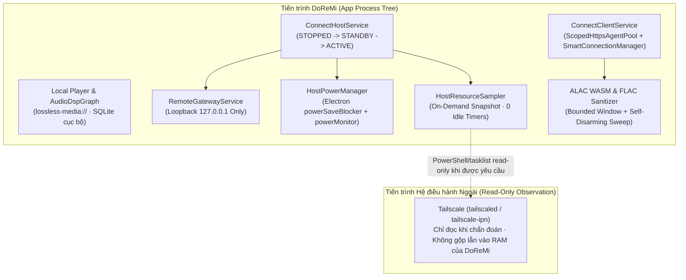

# PHASE 6.5 — RESOURCE MANAGEMENT ARCHITECTURE (`v1.0.0-rc.9`)

## 1. Mục tiêu Kiến trúc & Nguyên tắc Cốt lõi

Phase 6.5 chuyển đổi **DoReMi Personal Hybrid Server** thành một máy chủ nhạc cá nhân nhẹ, tiết kiệm tài nguyên và nhận thức trạng thái nguồn điện Windows để chạy ổn định dài hạn trên cả máy tính cấu hình phổ thông, trong khi bảo toàn tuyệt đối thứ tự ưu tiên bất biến của DoReMi:

1. **Priority 0 — Playback Stability**: Trình phát cục bộ (`Local Player`) luôn được ưu tiên tuyệt đối; khi Host tắt (`STOPPED`) và Client ngắt kết nối (`DISCONNECTED`), hệ thống tiêu thụ `0` cổng mạng, `0` luồng stream, `0` timer quét mạng và `0` khóa chống ngủ.
2. **Priority 1 — Original Audio Quality**: Không chuyển mã (zero transcoding), không hạ bitrate, không thay đổi bit depth / sample rate / số kênh nguồn; mọi tối ưu hóa chỉ loại bỏ chi phí bắt tay mạng dư thừa, ghi SQLite lặp lại và giữ vùng nhớ tạm không cần thiết.
3. **Zero Hidden Background Services**: Không cài Windows Service chạy ngầm cùng hệ điều hành, không tự bật lại Tailscale Funnel ngầm sau khi khởi động lại máy hay thức dậy từ Sleep, không thêm dependency runtime mới (`53` production packages, `0` lỗ hổng).

---

## 2. Bản đồ Phân tách Chủ sở hữu Tài nguyên (Resource Ownership Map)

### Quy tắc tách bạch đo lường (`ScopedHostResourceBreakdown`)
- **`mainProcess`**: Chỉ số thực của tiến trình Node/Electron Main (`rssBytes`, `heapUsedBytes`, `heapTotalBytes`, `externalBytes`, `arrayBuffersBytes`, `% CPU` chuẩn hóa toàn hệ thống và quy đổi 1 nhân).
- **`appProcessTree`**: Tổng bộ nhớ làm việc (`workingSetBytes`, `privateBytes`) và `% CPU` của toàn bộ cây tiến trình Electron DoReMi (`app.getAppMetrics()`).
- **`serverCounters`**: Số luồng đang truyền (`activeStreams`), thiết bị đang kết nối, thông lượng/tổng dung lượng tách riêng **`LAN Direct`** và **`Remote HTTPS`**, số mục trong các bộ đệm Host và số socket rảnh/bận trong `ScopedHttpsAgentPool`.
- **`tailscaleProcesses`**: Chỉ lấy mẫu chỉ-đọc (`sampled: true/false`) khi người dùng mở chẩn đoán chuyên sâu (`includeTailscaleProcesses: true`), tách rời hoàn toàn khỏi bộ nhớ của DoReMi.

---

## 3. Các Tối ưu hóa Runtime Trọng tâm trong Phase 6.5

### 3.1. `ScopedHttpsAgentPool` (Tái sử dụng kết nối Keep-Alive cách ly an toàn)
- Trước Phase 6.5 (`rc.8`), mọi yêu cầu HTTP Range/API trong `connect-client.ts` đều đặt `agent: false`, khiến mỗi mảnh `HTTP 206` phải thực hiện bắt tay TCP + TLS mới.
- Trong Phase 6.5:
  - Tạo khóa cách ly `ScopedHttpsAgentPool` theo bộ 4 thành phần: `(hostId, transport, pinnedSpkiSha256 | remoteOrigin, generation)`.
  - Mỗi agent giới hạn `keepAlive: true`, `maxSockets: 6`, `maxFreeSockets: 2`, `keepAliveMsecs: 15_000`.
  - **Bảo toàn bảo mật TLS**: Trên kết nối LAN Direct (`openPinnedHttpsRequest`), chứng chỉ SPKI SHA-256 được kiểm tra lại **cả khi tạo socket TLS mới lẫn khi tái sử dụng socket Keep-Alive có sẵn** trước khi gửi bất kỳ byte dữ liệu hay Bearer Token nào. Các yêu cầu dò tìm chưa ghép nối (`probeHost`, `enrollWithHost`) vẫn dùng `agent: false` để không bao giờ lưu socket của Host chưa tin cậy.
  - **Bảo toàn tạm dừng `> 30 giây`**: Không đặt `agent.timeout` cứng ở mức Agent để tránh ngắt nhầm luồng nhạc đang tạm dừng dưới áp lực backpressure; thay vào đó `req.setTimeout(0)` được kích hoạt sau khi nhận header phản hồi âm thanh hợp lệ, và `destroyScopedAgents(hostId?, transport?)` đóng sạch socket khi ngắt kết nối, đổi Host, thu hồi quyền hoặc chuyển mạng.

### 3.2. Giảm ghi SQLite lặp lại (`touchDeviceActivityThrottled`) & `deviceAuthCache`
- Trong `device-auth-service.ts`, cập nhật `last_activity_at` và `last_ip` vào SQLite chỉ ghi tối đa **1 lần mỗi 30 giây** trên mỗi thiết bị (trừ khi địa chỉ IP thay đổi thì ghi ngay), đồng thời tự động `flushPendingDeviceActivity()` khi thiết bị ngắt kết nối, Host dừng (`stop()`) hoặc Windows chuyển sang `suspend`.
- Bổ sung `deviceAuthCache` (`TTL = 10s`, tối đa `64` mục) lưu kết quả kiểm tra băm SHA-256 của Bearer Token trong bộ nhớ, và **xóa tức thì (`invalidateAuthCache`)** ngay khi thu hồi thiết bị, tắt quyền Remote của thiết bị, xoay vòng token hoặc dừng Host — đảm bảo không làm trễ việc thu hồi quyền dù chỉ 1 mili-giây.
- Trong `connect-repository.ts`, `updateHostConfig()` bỏ qua lệnh `UPDATE` vào SQLite nếu mọi trường cấu hình không thay đổi.

### 3.3. Tối ưu Giải mã ALAC WASM & FLAC Compatibility Plan
- Trong `remote-alac-decoder.ts`:
  - Sao chép độc lập vùng PCM giải mã (`Buffer.from(decodedChunks[0])`) thay vì tạo view chia sẻ trên `decodedChunks[0].buffer` của WebAssembly, giúp bộ nhớ tuyến tính WASM được thu hồi ngay sau `closeTrack(track)`.
  - Giới hạn cứng tối đa `3` chỉ mục hộp MP4/`moov` (`MAX_CACHED_INDEXES = 3`) và tối đa `6 MB` tổng dung lượng cửa sổ PCM (`MAX_TOTAL_WINDOW_BYTES = 6 MB`), kèm bộ hẹn giờ tự tắt (`unref()`) thu dọn cửa sổ sau `20 giây` không đọc và chỉ mục sau `60 giây` không đọc.
- Trong `flac-stream-sanitizer.ts` và `connect-client.ts`:
  - Khóa bộ đệm kế hoạch chuẩn hóa header FLAC từ xa theo `remote::<hostId>::<trackId>::<sourceRevision>` với trần dung lượng `8 MB` (`MAX_CACHED_PLANS = 64`), tự động xóa sạch qua `invalidateFlacPlansByPrefix` khi tệp nguồn trên Host thay đổi (`sourceRevision` lệch) hoặc khi ngắt kết nối Host.

---

## 4. Bảng Kiểm kê Toàn bộ Bộ đệm (Mandatory Cache Inventory Table)

| Tên bộ đệm (Cache) | Tệp sở hữu | Khóa định danh (Key) | Giới hạn kích thước / số lượng | Thời gian sống (TTL / Idle) | Điều kiện xóa / làm mới (Invalidation Trigger) | Hành vi khi Dừng Host / Ngắt kết nối |
|---|---|---|---|---|---|---|
| `libraryViewCache` | `host-service.ts` | Đơn bản theo Host đang chạy | `1` snapshot thư viện đã lọc nguồn chia sẻ | Kiểm tra `stateToken` SQLite tối đa mỗi `2s` | Thêm/xóa nguồn chia sẻ, sửa metadata/artwork/lyrics (`invalidateLibraryCache`), lệch `getLibraryStateToken()` | Gán `null` ngay lập tức (`0` mục) |
| `artworkCache` (+ `inflightArtwork`) | `host-service.ts` | `<trackId>:<variant>:<etag>` | Tối đa `48` mục **và** `<= 16 MB` | LRU trong phiên chạy Host | Đổi ETag ảnh bìa, xóa nguồn chia sẻ, `invalidateLibraryCache()` | `clear()` + xóa `inflightArtwork` (`0 B`) |
| `lyricsCache` | `host-service.ts` | `<trackId>:<sourceRev>:<sidecarMtimeMs>` | Tối đa `32` mục **và** `<= 1 MB` | LRU + kiểm tra `mtimeMs` tệp `.lrc`/`.txt` | Sửa Custom Lyrics, đổi tệp `.lrc` ngoài, đổi `modified_at_ms` bài hát | `clear()` ngay lập tức (`0 B`) |
| `deviceAuthCache` | `device-auth-service.ts` | `<scope>:<sha256(token)>` | Tối đa `64` mục | `10 giây` | Thu hồi thiết bị, tắt quyền Remote, xoay vòng token, dừng Host | `clear()` + `flushPendingDeviceActivity()` |
| `cachedStatus` (`TailscaleFunnelProvider`) | `tailscale-funnel-provider.ts` | `<port>|<mount>|<ownedTarget>` | `1` bản ghi dương tính (`ready` only) | `5 giây` (lỗi âm tính `0ms` để phản hồi tức thì) | Bật/tắt Funnel route, `forceRefresh: true` khi resume | Hết hạn tự nhiên / xóa khi đổi route |
| `ScopedHttpsAgentPool` | `connect-client.ts` | `<hostId>\|<transport>\|<pinOrOrigin>\|<gen>` | `maxSockets = 6`, `maxFreeSockets = 2` / agent | `keepAliveMsecs = 15s` | Đổi transport, thu hồi/lỗi xác thực, `suspend`, xóa Host | `destroyScopedAgents()` đóng toàn bộ socket |
| `remoteLyricsCache` (+ `inflightLyrics`) | `connect-client.ts` | `<hostId>:<trackId>` | Tối đa `48` mục (`<= 1 MB`) | Giữ qua bàn giao mạng cùng phiên | Lệch `sourceRevision`, tải lại thư viện sau cập nhật, đổi/ngắt Host | `clear()` toàn bộ mục của Host |
| `flacPlanCache` | `flac-stream-sanitizer.ts` | Local path+mtime hoặc `remote::<hostId>::<trackId>::<sourceRev>` | Tối đa `64` kế hoạch **và** `<= 8 MB` | LRU theo phiên phát | Đổi `mtime`/`size` cục bộ hoặc lệch `X-DoReMi-Source-Revision` từ xa | `invalidateFlacPlansByPrefix('remote::...')` |
| `RemoteAlacStreamManager` (`indexes` & `windows`) | `remote-alac-decoder.ts` | `<hostId>::<trackId>::<size>` | `<= 3` chỉ mục `moov`, `<= 8` cửa sổ **và** `<= 6 MB` PCM | Cửa sổ nghỉ `> 20s`, chỉ mục nghỉ `> 60s` | Seek xa vượt cửa sổ, đổi bài, ngắt kết nối Host | `clearAll()` + dừng timer tự tắt |
| `AlacStreamManager` (Local) | `alac-decoder.ts` | `<normalizedPath>:<mtimeMs>:<size>` | Tối đa `3` phiên giải mã cục bộ | Thu hồi sau `60s` không đọc | Đổi tệp nguồn hoặc đóng ứng dụng | `disposeSharedAlacStreamManager()` |

---

## 5. Ranh giới Chuẩn bị cho Phase 7.4 (`UI-BACKLOG-03` & `UI-BACKLOG-04`)

- Phase 6.5 cung cấp đầy đủ kênh IPC `CONNECT_HOST_GET_RESOURCE_BREAKDOWN` (`window.losslessApi.connectGetHostResourceBreakdown`) trả về `ScopedHostResourceBreakdown` được xác thực kiểu chặt chẽ và **không tạo bất kỳ vòng lặp lấy mẫu nền nào** khi không được gọi.
- Giao diện đồng hồ đo tài nguyên trực quan (`UI-BACKLOG-03`) và thiết kế lại trang Server tối giản (`UI-BACKLOG-04`) được giữ nguyên đúng lộ trình **Phase 7.4**, không triển khai sớm trong Phase 6.5.
