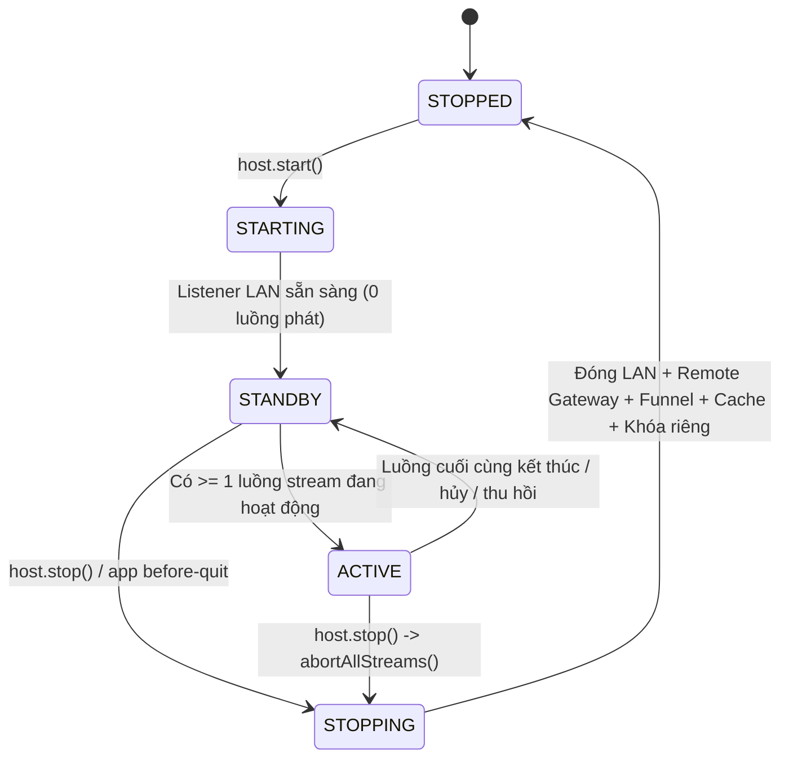

# PHASE 6.5 — RESOURCE LIFECYCLE & CLEANUP GUARANTEES (`v1.0.0-rc.9`)

## 1. Máy trạng thái Vòng đời Máy chủ (`ConnectHostService`)

### Đảm bảo Tài nguyên theo Từng Trạng thái

| Trạng thái | Cổng lắng nghe mạng | Bộ đệm RAM trên Host | Khóa riêng định danh (`privateKeyPem`) | Bộ hẹn giờ nền (`Timers`) | Khóa chống ngủ (`powerSaveBlocker`) |
|---|---|---|---|---|---|
| **`STOPPED` (Host OFF)** | `0` cổng LAN, `0` cổng Remote Gateway, `0` mDNS socket | `libraryViewCache = null`, `artworkCache = 0`, `lyricsCache = 0`, `deviceAuthCache = 0` | **Đã giải phóng khỏi bộ nhớ tiến trình** (`releasePrivateKeyFromMemory()`) | **`0` timer** | **Đã nhả hoàn toàn (`false`)** |
| **`STANDBY`** | Cổng LAN HTTPS đang mở (+ loopback Remote Gateway nếu người dùng bật Remote Access) | Khởi tạo lười (`libraryViewCache` vẫn bằng `0` cho tới khi có Client truy vấn thực tế) | Giữ trong phiên lắng nghe TLS/ký xác thực | `0` timer quét luồng khi không có phiên phát đang mở; mDNS định kỳ nhẹ nếu bật LAN discovery | Tắt với `follow-system` & `keep-awake-streaming` (sau `45s` đệm); bật nếu chọn `keep-awake-host-on` |
| **`ACTIVE`** | Đang truyền byte-range nguyên bản (`64 KB` highWaterMark, tôn trọng TCP backpressure) | Giới hạn chặt theo trần mục & dung lượng (`<= 16 MB` artwork, `<= 1 MB` lyrics) | Giữ trong phiên | Bộ quét luồng treo tự bật (`30s`, `unref()`) và tự tắt ngay khi `activeStreams === 0` | Bật với `keep-awake-streaming` và `keep-awake-host-on`; tắt với `follow-system` |

---

## 2. Vòng đời Luồng Truyền phát, File Handle & Tạm dừng `> 30 Giây`

1. **Mở tệp âm thanh có kiểm soát (`SharedFilesystemGuard` + `ConnectAudioStreamingService`)**:
   - Mọi yêu cầu `GET`/`HEAD /api/v1/stream/:trackId` kiểm tra `fs.realpath` chống thoát thư mục chia sẻ / symlink escape trước khi mở `FileHandle` chỉ-đọc.
   - Các phản hồi `HEAD`, `416 Range Not Satisfiable` và multi-range không hỗ trợ đóng `FileHandle` ngay lập tức trước khi trả header (`openFileHandlesDelta === 0`).
2. **Đọc theo khối nhỏ có kiểm soát áp lực ngược (`64 KB` chunks)**:
   - Không bao giờ đọc toàn bộ tệp FLAC/ALAC/WAV vào RAM; `pipeline(readStream, meter, res)` tự động tạm dừng đọc đĩa khi bộ đệm gửi TCP đầy (ví dụ khi trình phát Chromium trên Client bấm **Pause**).
3. **Phân biệt Tạm dừng Hợp lệ (`> 30s`) và Luồng Bị bỏ rơi (`Abandoned Stream`)**:
   - Không áp `socket.setTimeout(12_000)` lên đường dẫn `/stream/` và không đặt `agent.timeout` cứng trên `ScopedHttpsAgentPool`, giúp người dùng tạm dừng bài hát trên 30 giây (đã kiểm chứng thực tế `31,5 giây` trong `soak-phase65.ts`) rồi bấm phát tiếp mượt mà.
   - Khi Client hủy luồng (tua nhanh, chuyển bài, đóng ứng dụng), sự kiện `req.close` / `res.close` hoặc `AbortController` kích hoạt hàm `cleanup()` đóng `readStream`, `meter`, `FileHandle` và giải phóng slot trong `ResourceBudgetManager` ngay lập tức.
   - Đồng thời, mỗi thiết bị giới hạn tối đa `4` luồng đồng thời (`MAX_CONCURRENT_STREAMS_PER_DEVICE = 4`, tự động hủy luồng cũ nhất khi tua dồn dập) và bộ quét `sweepAbandonedStreams(180_000)` thu hồi mọi luồng rò rỉ bị đứt mạng im lặng quá 3 phút.

---

## 3. Vòng đời Kết nối Mạng & Bộ giải mã phía Client (`ConnectClientService`)

1. **Cách ly & Thu hồi `ScopedHttpsAgentPool`**:
   - Khi gọi `disconnect()`, đổi sang Host khác, xóa Host đã lưu, bị thu hồi quyền (`401`/`403`) hoặc khi hệ thống `suspend`, `destroyScopedAgents()` hủy toàn bộ socket đang mở và socket rảnh trong pool (`agentCount = 0, activeSockets = 0, freeSockets = 0`).
   - Khi bàn giao `Make-Before-Break` (`Remote HTTPS -> LAN Direct`), agent của đường truyền cũ được giải phóng êm sau khoảng thoát `600 ms`.
2. **Vòng đời Bộ nhớ Giải mã ALAC WASM (`RemoteAlacStreamManager`)**:
   - Dữ liệu PCM giải mã từ `@mgz-dev/alac` được sao chép sang `Buffer` độc lập kích thước nhỏ (`<= 512 KB` nguồn / cửa sổ) và gọi `closeTrack(track)` trong khối `finally`, ngăn không cho view `Uint8Array` giữ ghim bộ nhớ tuyến tính WASM.
   - Bộ hẹn giờ tự tắt (`unref()`) tự động giải phóng các cửa sổ PCM không đọc sau `20 giây`, giải phóng chỉ mục `moov` sau `60 giây`, và tự hủy chính timer đó ngay khi bộ đệm trống (`0` timer nền khi không nghe ALAC).
3. **Vòng đời Kế hoạch Tương thích FLAC (`flac-stream-sanitizer.ts`)**:
   - Kế hoạch ánh xạ dải byte ảo (loại bỏ ID3v2 đầu tệp / sửa khối `PICTURE` hỏng mà không chạm tệp gốc) gắn chặt với `X-DoReMi-Source-Revision` (`<size>:<mtimeMs>`). Khi tệp nguồn thay đổi hoặc Client ngắt kết nối, `invalidateFlacPlansByPrefix` giải phóng ngay các kế hoạch cũ.
